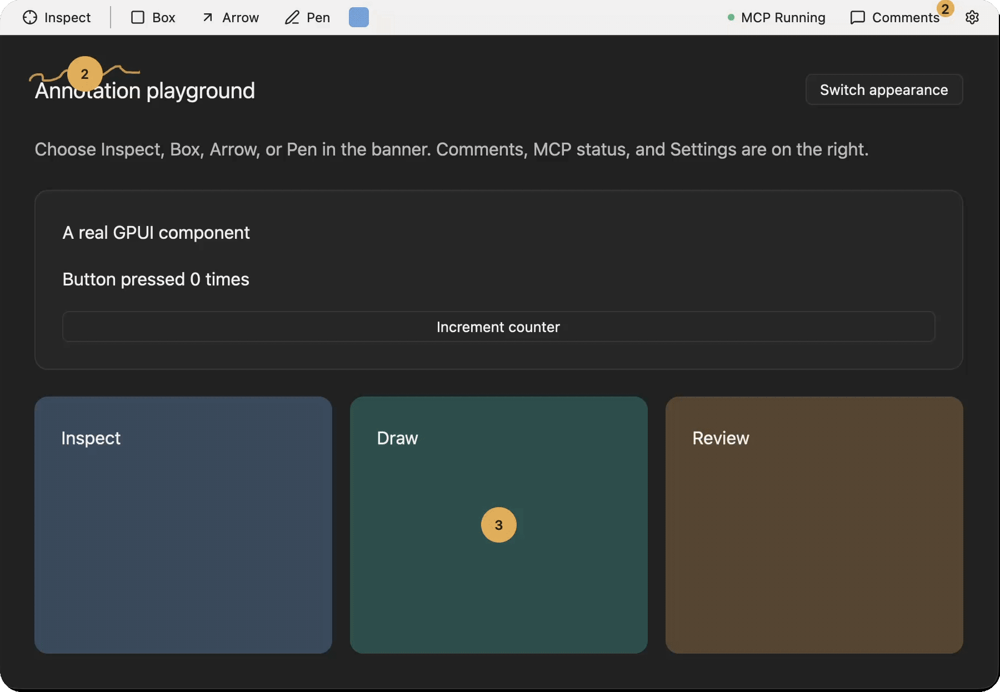

<a id="readme-top"></a>

<!-- PROJECT SHIELDS -->

[![Contributors][contributors-shield]][contributors-url]
[![Forks][forks-shield]][forks-url]
[![Stargazers][stars-shield]][stars-url]
[![Issues][issues-shield]][issues-url]
[![MIT License][license-shield]][license-url]

<!-- PROJECT LOGO -->
<br />
<div align="center">
  <a href="https://github.com/emmanuel-defreitas/gpui-agentation">
    
  </a>

  <h1 align="center">gpui-agentation</h1>

  <p align="center">
    🎯 Point at a running GPUI app, leave a note, and your coding agent gets the element, its bounds, and its Rust source location.
    <br />
    <a href="site/docs/reference.md"><strong>Explore the docs »</strong></a>
    <br />
    <br />
    <a href="https://emmanuel-defreitas.github.io/gpui-agentation/">View Demo</a>
    ·
    <a href="https://github.com/emmanuel-defreitas/gpui-agentation/issues">Report Bug</a>
    ·
    <a href="https://github.com/emmanuel-defreitas/gpui-agentation/issues">Request Feature</a>
  </p>
</div>

> **Version: 0.6.0.** Debug builds only — release builds expose no annotation API.
> macOS is the only supported native platform. Pinned to `gpui-pre =0.3.8`.

<!-- TABLE OF CONTENTS -->
<details>
  <summary>Table of Contents</summary>
  <ol>
    <li>
      <a href="#about-the-project">About The Project</a>
      <ul>
        <li><a href="#built-with">Built With</a></li>
      </ul>
    </li>
    <li>
      <a href="#getting-started">Getting Started</a>
      <ul>
        <li><a href="#prerequisites">Prerequisites</a></li>
        <li><a href="#installation">Installation</a></li>
      </ul>
    </li>
    <li>
      <a href="#usage">Usage</a>
      <ul>
        <li><a href="#inspect-and-annotate">Inspect and annotate</a></li>
        <li><a href="#capture-feedback">Capture feedback</a></li>
        <li><a href="#connect-your-agent">Connect your agent</a></li>
        <li><a href="#agent-skills">Agent skills</a></li>
      </ul>
    </li>
    <li><a href="#try-the-example">Try the Example</a></li>
    <li><a href="#roadmap">Roadmap</a></li>
    <li><a href="#contributing">Contributing</a></li>
    <li><a href="#license">License</a></li>
    <li><a href="#contact">Contact</a></li>
    <li><a href="#acknowledgments">Acknowledgments</a></li>
  </ol>
</details>

<!-- ABOUT THE PROJECT -->

## About The Project

[![gpui-agentation dashboard demo][product-screenshot]](https://emmanuel-defreitas.github.io/gpui-agentation/)

[Agentation](https://www.agentation.com/) annotates web pages through the DOM.
A native GPUI window has no DOM, so **gpui-agentation** registers screens (and
optional finer targets) with an ID, label, bounds, and Rust call site, then
attaches your note to that.

Use it when you would otherwise describe a UI bug to your agent in words or paste
a screenshot. Notes persist to a local JSON file, carry a status (pending,
acknowledged, resolved, dismissed) and a reply thread, and an agent reads them
over a loopback MCP server or REST/SSE.

It is a development tool. It annotates registered targets, not arbitrary pixels
(by default, the whole screen), and release builds do not include it. For
production telemetry or session replay, use something else.

<p align="right">(<a href="#readme-top">back to top</a>)</p>

### Built With

[![Rust][Rust-shield]][Rust-url]
[![GPUI][GPUI-shield]][GPUI-url]
[![MCP][MCP-shield]][MCP-url]

<p align="right">(<a href="#readme-top">back to top</a>)</p>

<!-- GETTING STARTED -->

## Getting Started

Add gpui-agentation to your own GPUI app in three steps: install the crate,
initialize once at launch, then mount and wrap your screen.

### Prerequisites

- **macOS** with Xcode command-line tools
- **Rust** via [rustup](https://rustup.rs/) (the repository pins the toolchain)

Ely is bundled, so there is nothing else to install.

### Installation

1. Add the crate with the native feature set:

   ```sh
   cargo add gpui-agentation --no-default-features --features native
   ```

2. The crate does not exist in release builds, so every call sits behind
   `#[cfg(debug_assertions)]` and release returns your content unchanged:

   ```rust
   // Launch: serve Agentation's assets, then initialize.
   let app = gpui_platform::application();
   #[cfg(debug_assertions)]
   let app = app.with_assets(gpui_agentation::Assets);
   app.run(|cx| {
       #[cfg(debug_assertions)]
       gpui_agentation::init(cx).expect("initialize Agentation");
       // ...open your window
   });

   // Window setup: app name, route, notes file, local port. Keep `feedback`
   // in a field of your root view that carries the same cfg.
   #[cfg(debug_assertions)]
   let feedback = gpui_agentation::Agentation::mount(
       "My app", "gpui://my-app/home", "target/agentation/feedback.json", 4748, window, cx,
   )?;

   // Render: wrap the screen in debug builds; release keeps `content` as is.
   #[cfg(debug_assertions)]
   let content = self.feedback.root("home", "Home screen", content, window, cx);
   content
   ```

3. Add `target(id, label, child)` only where you want finer inspection. Ordinary
   controls need no wrappers. Agentation handles its Ely setup, assets, and focus
   internally.

Want your agent to do this for you? Use the [setup skill](#agent-skills).

More:

- [Example app](example/README.md): all of this in one `devtools` module
- [Setup guide](site/docs/consumer-setup.md)
- [Customization](site/docs/reference.md#settings)

<p align="right">(<a href="#readme-top">back to top</a>)</p>

<!-- USAGE EXAMPLES -->

## Usage

### Inspect and annotate

The toolbar is its own window, docked to the right edge of your app. It follows
your app when you move or resize it.

| Tool | What it does |
| --- | --- |
| **Inspect** | Pick an element. Saves its source and properties as a numbered note. |
| **Box**, **Arrow**, **Pen** | Draw on the live window. |
| **Comment** | Drop a numbered pin with a note. |
| **Textbox** | Put plain text on the canvas. |

Drawing tools need the **Annotation mode** switch on. Inspect does not.

**Inspect an element**

1. Click **Inspect**, then click an element.
2. Optional: change width, height, padding, margin, border, or opacity with the sliders.
3. Click the numbered pin to add a comment.
4. Click **Stop** in the Inspector header to leave Inspect.

Press **Esc** or click elsewhere to pick another element.


Your agent gets the comment, the property snapshot, and any style changes with
suggested Rust builder calls. Click the last breadcrumb segment to open the
source line in `$EDITOR` (Zed by default; VS Code, Cursor, and VSCodium work too).
Other editors copy the path instead.

**Draw**

Point your agent at the exact spot with an arrow, box, or pen stroke.


**Shortcuts** (annotation mode on)

| Keys | Action |
| --- | --- |
| `I` `B` `A` `P` `C` `T` | Pick a tool |
| `Ctrl/Cmd+S` | Save the draft |
| `Ctrl/Cmd+Z`, `Ctrl/Cmd+Shift+Z` | Undo, redo |
| `Delete` | Remove the selected note |

**Pins, textboxes, mentions**

- Drag a pin to move it, separately from its drawing.
- Textbox: click to select, drag to move, Enter or double-click to edit.
- In a comment, type `@` to pick a note or `#12` to preview pin 12.
  Enter or Tab inserts `@#12`. Esc closes the list.
- Right-click a note for Edit, Delete, and Color.

**Toolbar, menus, Settings**

- **Comments**, **Settings**, and **Close** sit at the bottom of the toolbar.
- **Close** hides it. **Debug → Show Toolbar** brings it back.
- Add `gpui_agentation::debug_menu()` to `cx.set_menus(...)` to get the Debug menu.
- Settings opens from the macOS menu-bar icon or `⌘⌥S`.

### Capture feedback

Write a comment and save it. Open **Comments → Copy** to copy your feedback as
Markdown, ready to paste to your agent.



### Connect your agent

1. Keep the debug app running.
2. Open **Settings → MCP** and turn the server on.
3. Copy the config into your MCP client.

The endpoint runs on loopback. Clients that require stdio can use the
[MCP bridge](site/docs/package-layout.md#mcp-client).

- MCP Registry name: `mcp-name: io.github.emmanuel-defreitas/gpui-agentation`

_For more examples, please refer to the [Reference](site/docs/reference.md)._

### Agent skills

Two skills help your agent set up Agentation and work through feedback.
Install them from [skills.sh](https://skills.sh) (needs Node.js 22.20+).

| Skill | Use it to | Try |
| --- | --- | --- |
| [gpui-agentation-setup](skills/gpui-agentation-setup/SKILL.md) | Add Agentation to a GPUI app. | "Use gpui-agentation-setup to add development annotations to this app." |
| [gpui-agentation-explore](skills/gpui-agentation-explore/SKILL.md) | Read your app's feedback over MCP and act on it. | "Use gpui-agentation-explore to summarize pending feedback without changing notes." |

1. From your app's folder, run:

   ```sh
   npx skills add emmanuel-defreitas/gpui-agentation
   ```

2. Pick the skills and agents when asked.
3. Start a new conversation, then run `/gpui-agentation-setup` or
   `/gpui-agentation-explore`, or paste a prompt above.

Options:

- One skill only: add `--skill gpui-agentation-setup`.
- Every project: add `-g`.
- Update later: `npx skills update`.

Skills are instructions only. `explore` also needs your debug app running with
**Settings → MCP** on. See [Connect your agent](#connect-your-agent).

<p align="right">(<a href="#readme-top">back to top</a>)</p>

<!-- DEMO -->

## Try the Example

Clone the repository and run the example app:

```sh
git clone https://github.com/emmanuel-defreitas/gpui-agentation
cd gpui-agentation
make example
```

1. Choose **Inspect**, **Box**, **Arrow**, or **Pen**.
2. Select an element or draw, then write a comment and save.
3. Open **Comments → Copy** to copy your feedback as Markdown.

See the [example app](example/README.md) for the full integration.

<p align="right">(<a href="#readme-top">back to top</a>)</p>

<!-- ROADMAP -->

## Roadmap

- [x] Inspect, Box, Arrow, and Pen annotation tools
- [x] Loopback MCP server plus REST/SSE access
- [x] Add text annotation tool
- [x] Update Comment annotation UX
- [ ] Add gpui-devtools features from [joris-gallot/gpui-devtools](https://github.com/joris-gallot/gpui-devtools)
- [ ] Extends AI features from [hexuria/gpui-agent](https://github.com/hexuria/gpui-agent)
- [ ] Stabilize the API toward 1.0
- [ ] Port MCP tools to a standalone macOS companion app

See the [open issues](https://github.com/emmanuel-defreitas/gpui-agentation/issues)
for a full list of proposed features (and known issues).

<p align="right">(<a href="#readme-top">back to top</a>)</p>

<!-- CONTRIBUTING -->

## Contributing

Contributions are welcome. Read [CONTRIBUTING.md](CONTRIBUTING.md) for the
workflow, checks, and release steps.

<p align="right">(<a href="#readme-top">back to top</a>)</p>

<!-- LICENSE -->

## License

Distributed under the MIT License. See [`LICENSE`](LICENSE) for more information.

<p align="right">(<a href="#readme-top">back to top</a>)</p>

<!-- CONTACT -->

## Contact

Emmanuel De Freitas — [@emmanuel-defreitas](https://github.com/emmanuel-defreitas)

Project Link: [https://github.com/emmanuel-defreitas/gpui-agentation](https://github.com/emmanuel-defreitas/gpui-agentation)

<p align="right">(<a href="#readme-top">back to top</a>)</p>

<!-- ACKNOWLEDGMENTS -->

## Acknowledgments

- Inspired by [Agentation](https://www.agentation.com/). Independent GPUI
  implementation. Original MIT attribution is preserved in [ORIGIN.md](ORIGIN.md).
- Built on [GPUI](https://www.gpui.rs/) and the
  [Model Context Protocol](https://modelcontextprotocol.io/).
- [Ely GPUI Components](https://elygpui.com/) by the Ely contributors
  ([source](https://git.zacharyzhang.com/ZacharyZhang-NY/Ely-GPUI-Components)).
  The toolbar, theme, and assets are Ely, bundled unchanged at a pinned
  revision under the MIT license.
- [gpui-devtools](https://github.com/joris-gallot/gpui-devtools) by
  [Joris Gallot](https://github.com/joris-gallot). The inspector's style editing
  and export approach comes from it (MIT), rewritten on Ely components.
- [Best-README-Template](https://github.com/othneildrew/Best-README-Template)

<p align="right">(<a href="#readme-top">back to top</a>)</p>

<!-- MARKDOWN LINKS & IMAGES -->

[contributors-shield]: https://img.shields.io/github/contributors/emmanuel-defreitas/gpui-agentation.svg?style=for-the-badge
[contributors-url]: https://github.com/emmanuel-defreitas/gpui-agentation/graphs/contributors
[forks-shield]: https://img.shields.io/github/forks/emmanuel-defreitas/gpui-agentation.svg?style=for-the-badge
[forks-url]: https://github.com/emmanuel-defreitas/gpui-agentation/network/members
[stars-shield]: https://img.shields.io/github/stars/emmanuel-defreitas/gpui-agentation.svg?style=for-the-badge
[stars-url]: https://github.com/emmanuel-defreitas/gpui-agentation/stargazers
[issues-shield]: https://img.shields.io/github/issues/emmanuel-defreitas/gpui-agentation.svg?style=for-the-badge
[issues-url]: https://github.com/emmanuel-defreitas/gpui-agentation/issues
[license-shield]: https://img.shields.io/github/license/emmanuel-defreitas/gpui-agentation.svg?style=for-the-badge
[license-url]: https://github.com/emmanuel-defreitas/gpui-agentation/blob/main/LICENSE
[product-screenshot]: https://emmanuel-defreitas.github.io/gpui-agentation/assets/motion/dashboard-demo.gif?v=35d6cdd052b5
[Rust-shield]: https://img.shields.io/badge/Rust-000000?style=for-the-badge&logo=rust&logoColor=white
[Rust-url]: https://www.rust-lang.org/
[GPUI-shield]: https://img.shields.io/badge/GPUI-084CCF?style=for-the-badge&logoColor=white
[GPUI-url]: https://www.gpui.rs/
[MCP-shield]: https://img.shields.io/badge/MCP-000000?style=for-the-badge&logoColor=white
[MCP-url]: https://modelcontextprotocol.io/
