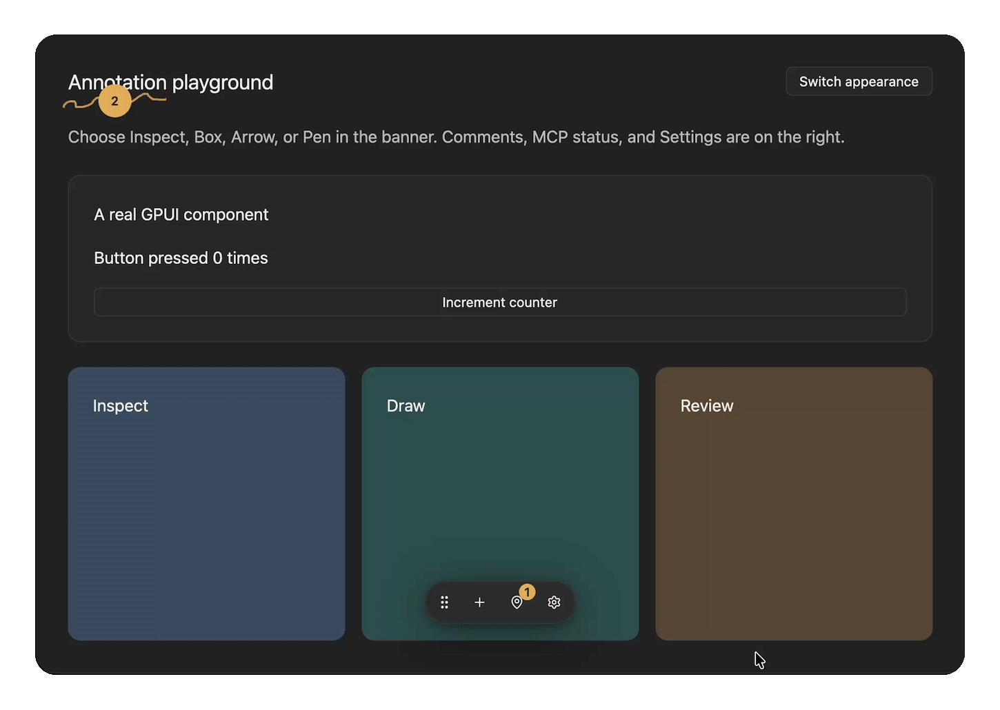
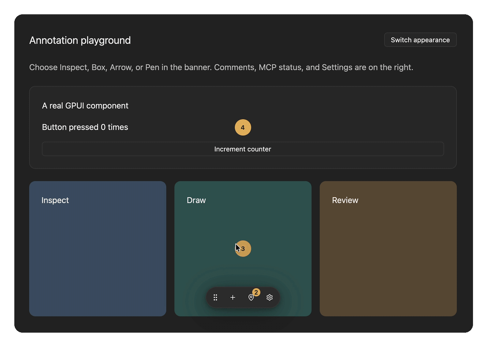
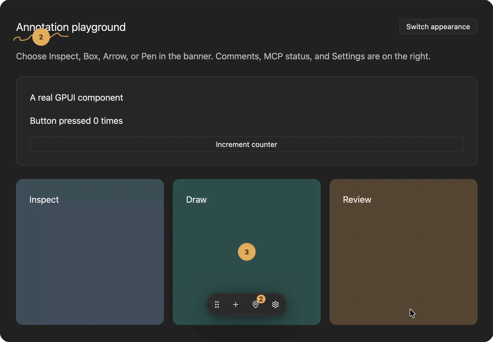

<a id="readme-top"></a>

<!-- PROJECT SHIELDS -->

[![Contributors][contributors-shield]][contributors-url]
[![Forks][forks-shield]][forks-url]
[![Stargazers][stars-shield]][stars-url]
[![Issues][issues-shield]][issues-url]
[![MIT License][license-shield]][license-url]

<!-- PROJECT LOGO -->
<br />
<div align="center">
  <a href="https://github.com/emmanuel-defreitas/gpui-agentation">
    
  </a>

  <h1 align="center">gpui-agentation</h1>

  <p align="center">
    🎯 Point at a running GPUI app, leave a note, and your coding agent gets the element, its bounds, and its Rust source location.
    <br />
    <a href="docs/reference.md"><strong>Explore the docs »</strong></a>
    <br />
    <br />
    <a href="https://emmanuel-defreitas.github.io/gpui-agentation/">View Demo</a>
    ·
    <a href="https://github.com/emmanuel-defreitas/gpui-agentation/issues">Report Bug</a>
    ·
    <a href="https://github.com/emmanuel-defreitas/gpui-agentation/issues">Request Feature</a>
  </p>
</div>

> **Version: 6.0.0.** Debug builds only — release builds expose no annotation API.
> Pinned to `gpui-pre =0.3.8`.

<!-- TABLE OF CONTENTS -->
<details>
  <summary>Table of Contents</summary>
  <ol>
    <li>
      <a href="#about-the-project">About The Project</a>
      <ul>
        <li><a href="#built-with">Built With</a></li>
      </ul>
    </li>
    <li>
      <a href="#getting-started">Getting Started</a>
      <ul>
        <li><a href="#prerequisites">Prerequisites</a></li>
        <li><a href="#installation">Installation</a></li>
      </ul>
    </li>
    <li>
      <a href="#usage">Usage</a>
      <ul>
        <li><a href="#inspect-and-annotate">Inspect and annotate</a></li>
        <li><a href="#capture-feedback">Capture feedback</a></li>
        <li><a href="#connect-your-agent">Connect your agent</a></li>
        <li><a href="#agent-skills">Agent skills</a></li>
      </ul>
    </li>
    <li><a href="#try-the-demo">Try the Demo</a></li>
    <li><a href="#roadmap">Roadmap</a></li>
    <li><a href="#contributing">Contributing</a></li>
    <li><a href="#license">License</a></li>
    <li><a href="#contact">Contact</a></li>
    <li><a href="#acknowledgments">Acknowledgments</a></li>
  </ol>
</details>

<!-- ABOUT THE PROJECT -->

## About The Project

[![gpui-agentation dashboard demo][product-screenshot]](https://emmanuel-defreitas.github.io/gpui-agentation/)

[Agentation](https://www.agentation.com/) annotates web pages through the DOM.
A native GPUI window has no DOM, so **gpui-agentation** registers screens (and
optional finer targets) with an ID, label, bounds, and Rust call site, then
attaches your note to that.

Use it when you would otherwise describe a UI bug to your agent in words or paste
a screenshot. Notes persist to a local JSON file, carry a status (pending,
acknowledged, resolved, dismissed) and a reply thread, and an agent reads them
over a loopback MCP server or REST/SSE.

It is a development tool. It annotates registered targets, not arbitrary pixels
(by default, the whole screen), and release builds do not include it. For
production telemetry or session replay, use something else.

<p align="right">(<a href="#readme-top">back to top</a>)</p>

### Built With

[![Rust][Rust-shield]][Rust-url]
[![GPUI][GPUI-shield]][GPUI-url]
[![MCP][MCP-shield]][MCP-url]

<p align="right">(<a href="#readme-top">back to top</a>)</p>

<!-- GETTING STARTED -->

## Getting Started

Add gpui-agentation to your own GPUI app in three steps: install the crate,
initialize once at launch, then mount and wrap your screen.

### Prerequisites

- **macOS** with Xcode command-line tools
- **Rust** via [rustup](https://rustup.rs/) (the repository pins the toolchain)
- **Python 3** (only needed to run the bundled demo)

Ely is bundled, so there is nothing else to install.

### Installation

1. Add the crate with the native feature set:

   ```sh
   cargo add gpui-agentation --no-default-features --features native
   ```

2. The crate does not exist in release builds, so every call sits behind
   `#[cfg(debug_assertions)]` and release returns your content unchanged:

   ```rust
   // Launch: serve Agentation's assets, then initialize.
   let app = gpui_platform::application();
   #[cfg(debug_assertions)]
   let app = app.with_assets(gpui_agentation::Assets);
   app.run(|cx| {
       #[cfg(debug_assertions)]
       gpui_agentation::init(cx).expect("initialize Agentation");
       // ...open your window
   });

   // Window setup: app name, route, notes file, local port. Keep `feedback`
   // in a field of your root view that carries the same cfg.
   #[cfg(debug_assertions)]
   let feedback = gpui_agentation::Agentation::mount(
       "My app", "gpui://my-app/home", "target/agentation/feedback.json", 4748, window, cx,
   )?;

   // Render: wrap the screen in debug builds; release keeps `content` as is.
   #[cfg(debug_assertions)]
   let content = self.feedback.root("home", "Home screen", content, window, cx);
   content
   ```

3. Add `target(id, label, child)` only where you want finer inspection. Ordinary
   controls need no wrappers. Agentation handles its Ely setup, assets, and focus
   internally.

The [consumer example](examples/consumer/README.md) keeps all of this in one
`devtools` module. More: [setup guide](docs/consumer-setup.md),
[setup skill](skills/gpui-agentation-setup/SKILL.md) for agents, and
[customization](docs/reference.md#settings).

<p align="right">(<a href="#readme-top">back to top</a>)</p>

<!-- USAGE EXAMPLES -->

## Usage

### Inspect and annotate

Turn **Annotations on**, then choose **Inspect**, **Box**, **Arrow**, **Pen**,
**Comment**, or **Textbox**. Select an element or draw
on the screen. Inspect surfaces the element's ID, label, bounds, and Rust call
site.



Draw an arrow (or a box or freehand pen stroke) to point your agent at exactly
the right spot.



While annotation mode is on, use **I / B / A / P / C / T** to select a tool.
Shortcuts appear on the tool buttons. **Ctrl/Cmd+S** saves the current draft;
**Ctrl/Cmd+Z** and **Ctrl/Cmd+Shift+Z** undo and redo annotation changes.
**Delete/Backspace** removes a selected annotation when its text field is not
being edited. Text fields retain their ordinary typing and text undo behavior.

Textboxes use plain text with one style and size. Click a textbox to edit it;
saving displays the text directly on the canvas without opening a comment.
Drag numbered pins to reposition them independently of their drawings.

Include `gpui_agentation::debug_menu()` in your host's `cx.set_menus(...)` list
to expose the controls in the native **Debug** menu. `Agentation::root` routes
those menu commands to the active window. **Settings → Toolbar → None** hides
the embedded toolbar. Toolbar placement persists per application in its notes
file and is shared by windows mounted against that file.

### Capture feedback

Write a comment and save it. Open **Comments → Copy** to copy your feedback as
Markdown, ready to paste to your agent.


Move the toolbar out of the way whenever it overlaps the UI you are inspecting.



### Connect your agent

1. Keep the debug app running.
2. Open **Settings → MCP** and turn the server on.
3. Copy the config into your MCP client.

The endpoint runs on loopback. Clients that require stdio can use the
[MCP bridge](docs/package-layout.md#mcp-client).

- MCP Registry name: `mcp-name: io.github.emmanuel-defreitas/gpui-agentation`

_For more examples, please refer to the [Reference](docs/reference.md)._

### Agent skills

Give your coding agent a reusable workflow for installation or exploring a
running app's feedback. Both skills live under [`skills/`](skills/):

| Skill                                                              | Use it to                                                                                                                                     |
| ------------------------------------------------------------------ | --------------------------------------------------------------------------------------------------------------------------------------------- |
| [gpui-agentation-setup](skills/gpui-agentation-setup/SKILL.md)     | Integrate the native library into a GPUI app, register screens, and verify debug and release builds.                                          |
| [gpui-agentation-explore](skills/gpui-agentation-explore/SKILL.md) | Discover the connected MCP tools, read sessions and notes, export Markdown, and work through requested feedback with verified status updates. |

From a clone of this repository, copy either skill directory into your host
project's `.agents/skills/` directory, or into `~/.agents/skills/` for personal
use across projects. For example, to install the exploration skill in a host:

```sh
mkdir -p /path/to/your-app/.agents/skills
cp -R skills/gpui-agentation-explore /path/to/your-app/.agents/skills/
```

In Zed, start a new conversation after copying, then invoke
`/gpui-agentation-explore` or `/gpui-agentation-setup`. Other agents can load the
linked `SKILL.md` directly or use their supported skill directory. Try:
“Use gpui-agentation-explore to discover my app's MCP tools and summarize pending
feedback without changing notes.” Skills provide instructions; connect the
running debug app's MCP server separately using the steps above.

<p align="right">(<a href="#readme-top">back to top</a>)</p>

<!-- DEMO -->

## Try the Demo

Clone the repository and run the bundled demo app:

```sh
git clone https://github.com/emmanuel-defreitas/gpui-agentation
cd gpui-agentation
make dev
```

1. Choose **Inspect**, **Box**, **Arrow**, or **Pen**.
2. Select an element or draw, then write a comment and save.
3. Open **Comments → Copy** to copy your feedback as Markdown.

For rebuilds on save, enable **Settings → Hot reload → Server status**. It rebuilds
and restarts the app after a successful build; in-memory state resets, saved
annotations survive. [Demo details](demo/README.md)

<p align="right">(<a href="#readme-top">back to top</a>)</p>

<!-- ROADMAP -->

## Roadmap

- [x] Inspect, Box, Arrow, and Pen annotation tools
- [x] Loopback MCP server plus REST/SSE access
- [x] Hot reload for rebuild-on-save
- [x] Add text annotation tool
- [x] Update Comment annotation UX
- [ ] Add gpui-devtools features from [joris-gallot/gpui-devtools](https://github.com/joris-gallot/gpui-devtools)
- [ ] Extends AI features from [hexuria/gpui-agent](https://github.com/hexuria/gpui-agent)
- [ ] Stabilize the API toward 1.0
- [ ] Port MCP tools to a standalone macOS companion app

See the [open issues](https://github.com/emmanuel-defreitas/gpui-agentation/issues)
for a full list of proposed features (and known issues).

<p align="right">(<a href="#readme-top">back to top</a>)</p>

<!-- CONTRIBUTING -->

## Contributing

Contributions are what make the open source community such an amazing place to
learn, inspire, and create. Any contributions you make are **greatly appreciated**.

If you have a suggestion that would make this better, please fork the repo and
create a pull request. You can also simply open an issue with the tag
"enhancement". Don't forget to give the project a star! Thanks again!

1. Fork the Project
2. Create your Feature Branch (`git checkout -b feature/123-amazing-feature`)
3. Commit your Changes (`git commit -m 'feat: add amazing feature'`)
4. Push to the Branch (`git push origin feature/123-amazing-feature`)
5. Open a Pull Request

Changes target `dev`, then promote through `next` to `main`. Run `make ci` for
checks or `make help` for available commands.

Before promotion, run `make release-prepare` to calculate the next stable version
from conventional commits and synchronize Cargo, the lockfile, Registry metadata,
documentation, skills, and site references. Settings, CLI, and MCP versions derive
from Cargo at build time. Review that diff and update `CHANGELOG.md` before
committing through the promotion PRs. CI and release tagging reject mismatched
versions. See the [release policy](.github/BRANCH-AND-RELEASE-POLICY.md).

<p align="right">(<a href="#readme-top">back to top</a>)</p>

<!-- LICENSE -->

## License

Distributed under the MIT License. See [`LICENSE`](LICENSE) for more information.

<p align="right">(<a href="#readme-top">back to top</a>)</p>

<!-- CONTACT -->

## Contact

Emmanuel De Freitas — [@emmanuel-defreitas](https://github.com/emmanuel-defreitas)

Project Link: [https://github.com/emmanuel-defreitas/gpui-agentation](https://github.com/emmanuel-defreitas/gpui-agentation)

<p align="right">(<a href="#readme-top">back to top</a>)</p>

<!-- ACKNOWLEDGMENTS -->

## Acknowledgments

- Inspired by [Agentation](https://www.agentation.com/). Independent GPUI
  implementation. Original MIT attribution is preserved in [ORIGIN.md](ORIGIN.md).
- Built on [GPUI](https://www.gpui.rs/) and the
  [Model Context Protocol](https://modelcontextprotocol.io/).
- [Best-README-Template](https://github.com/othneildrew/Best-README-Template)

<p align="right">(<a href="#readme-top">back to top</a>)</p>

<!-- MARKDOWN LINKS & IMAGES -->

[contributors-shield]: https://img.shields.io/github/contributors/emmanuel-defreitas/gpui-agentation.svg?style=for-the-badge
[contributors-url]: https://github.com/emmanuel-defreitas/gpui-agentation/graphs/contributors
[forks-shield]: https://img.shields.io/github/forks/emmanuel-defreitas/gpui-agentation.svg?style=for-the-badge
[forks-url]: https://github.com/emmanuel-defreitas/gpui-agentation/network/members
[stars-shield]: https://img.shields.io/github/stars/emmanuel-defreitas/gpui-agentation.svg?style=for-the-badge
[stars-url]: https://github.com/emmanuel-defreitas/gpui-agentation/stargazers
[issues-shield]: https://img.shields.io/github/issues/emmanuel-defreitas/gpui-agentation.svg?style=for-the-badge
[issues-url]: https://github.com/emmanuel-defreitas/gpui-agentation/issues
[license-shield]: https://img.shields.io/github/license/emmanuel-defreitas/gpui-agentation.svg?style=for-the-badge
[license-url]: https://github.com/emmanuel-defreitas/gpui-agentation/blob/main/LICENSE
[product-screenshot]: https://emmanuel-defreitas.github.io/gpui-agentation/assets/motion/dashboard-demo.gif?v=35d6cdd052b5
[Rust-shield]: https://img.shields.io/badge/Rust-000000?style=for-the-badge&logo=rust&logoColor=white
[Rust-url]: https://www.rust-lang.org/
[GPUI-shield]: https://img.shields.io/badge/GPUI-084CCF?style=for-the-badge&logoColor=white
[GPUI-url]: https://www.gpui.rs/
[MCP-shield]: https://img.shields.io/badge/MCP-000000?style=for-the-badge&logoColor=white
[MCP-url]: https://modelcontextprotocol.io/
