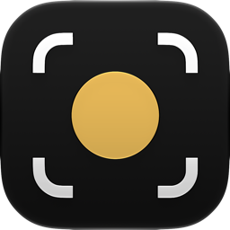

<div align="center">
  
</div>

# Consumer app

A complete plain GPUI app using Agentation through its public API, with no
direct Ely dependency, initialization, or focus scope. It belongs to
the root Cargo workspace and runs in both debug and release builds.

```sh
# From the repository root:
cargo run -p agentation-consumer --locked
cargo run -p agentation-consumer --release --locked

# Or bundle it as a macOS .app so the Dock shows the project icon:
make example-app
```

Debug adds the banner, screen-level inspection, drawing, Comments, Settings,
and MCP at `http://127.0.0.1:4750/mcp`. Notes live in
`target/consumer/feedback.json`. Release runs the same app without annotations.

- `src/main.rs`: a screen of varied controls — text, stat cards, buttons,
  inputs, a switch, and status badges — across two routes.
- `src/devtools.rs`: Agentation assets/init, root mounting, route hook, the
  `devtools.target` wrapper, and all debug gates. Agentation owns its internal
  UI and focus setup.
- `assets/icon.png`: the app icon, turned into an `.icns` by
  `scripts/bundle-example.py` (and by `cargo bundle`, via `Cargo.toml`).

Each section is wrapped in `devtools.target(id, label, child)`, so Inspect
selects it on its own; the surrounding screen stays a fallback target. With
annotation mode on, right-clicking the canvas opens the tools menu.

Follow the [consumer setup guide](../site/docs/consumer-setup.md) to adapt the
example, choose dependencies and storage, and connect an agent.
